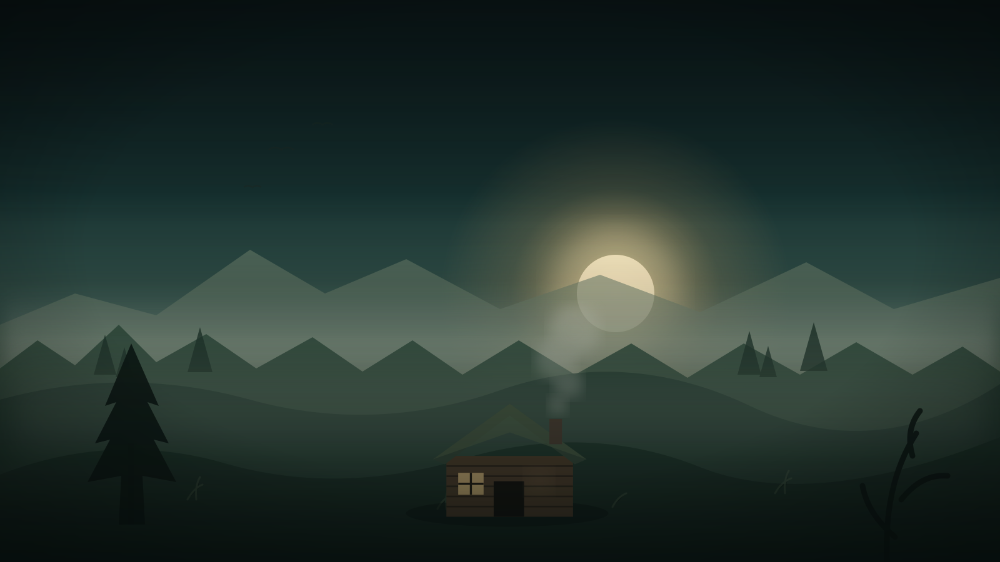
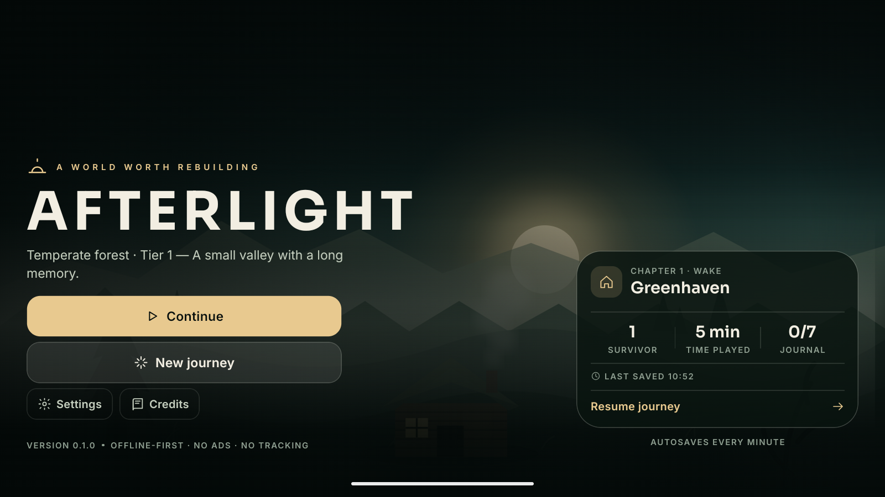
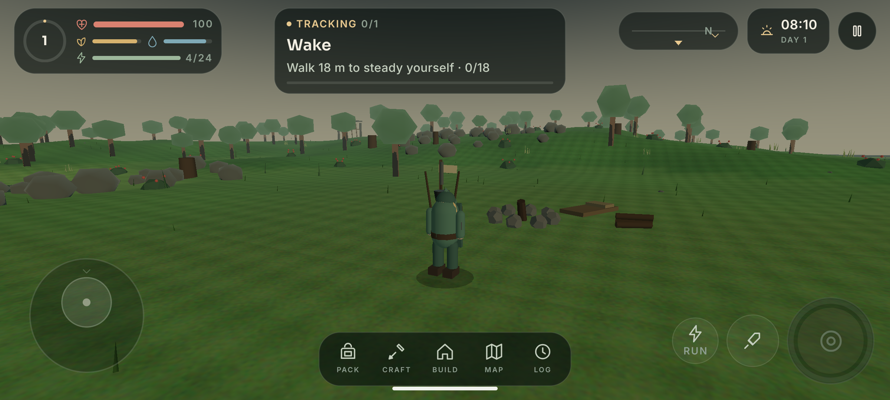

# AFTERLIGHT

**A world worth rebuilding.**

AFTERLIGHT is a third-person survival RPG for Android and iOS set in Greenhaven, a valley
reclaimed by nature after a failed energy project. Gather, craft, build a homestead, follow a
signal into the woods, and find out what the light left behind.



| Main menu | In the valley |
| --- | --- |
|  |  |

---

## Status

**Playable vertical slice — Chapter 1: The Signal.**

The full gather → craft → build → explore → return loop is implemented, offline-first, with a
persistent save, a seven-step opening chapter, a night threat, and a complete audiovisual
presentation. See [docs/DEVELOPMENT_LOG.md](docs/DEVELOPMENT_LOG.md) for exact per-phase status
and [docs/KNOWN_ISSUES.md](docs/KNOWN_ISSUES.md) for what is not yet verified.

> **On-device status:** a signed **release APK** boots, enters the world, accepts touch input,
> runs the simulation, saves and resumes on a Samsung Galaxy S22+ (SM-S906U, Android 16). The
> release-only R8 crash on the first journey is fixed. Frame pacing profiling, full chapter QA and
> the iOS build remain the gates before submission; see
> [docs/DEVELOPMENT_LOG.md](docs/DEVELOPMENT_LOG.md).

---

## What is in the slice

**The valley**
- Handcrafted Greenhaven with a lake, forest edges, quarry outcrops, a lookout hill,
  a broken footbridge, an abandoned ranger camp and a sealed north gate.
- Deterministic world generation: harvested nodes persist; visual scatter never touches the save.
- Day/night cycle with moving sun, stars, fog palettes and colour-graded lighting.
- 120+ gatherable trees, rocks, berry bushes, fibre and springs, with respawn timers.

**The survivor**
- Camera-relative third-person movement, walk/run/sprint, stamina, slopes, water, collision.
- Touch joystick, drag-to-look camera, hold-to-gather, contextual interact button.
- Health, hunger, thirst and stamina with warnings, slow recovery, and fair failure
  (you wake at camp; nothing permanent is lost).

**Crafting & building**
- Tools, torches, rope, cooked food, clean water, medkits and a pack upgrade.
- Campfire and workbench stations gate recipes; crafting is queued with cancellation and refunds.
- Grid-snapped building with rotation, ghost preview, validity reasons, refunds and persistence:
  campfire, shelter, workbench, storage crate, water collector, crop plot.
- Passive production (water, crops) that accumulates while you are away.

**Exploration & story**
- Three points of interest with discoveries, journal entries and authored audio-log fragments.
- Seven-step opening chapter with rewards, an authored climax and a cinematic finale.
- A sequential homestead director with 12 goal steps, rewards and a journal roadmap, so there is
  always a concrete next action after the chapter.
- A locked route teaser to the Silent City (next chapter).

**Threat**
- The Hollow Stalker appears after nightfall, hunts outside the safe camp, fears torches,
  and can be driven off with an axe. It never deletes your progress.

**Presentation**
- Fully original 3D art from the supplied AFTERLIGHT kit, instanced for mobile, with 256 px
  albedo textures, generated normal maps, textured props and instanced contact shadows.
- 26 procedurally synthesised audio files: music, day/night ambience, UI, gathering,
  crafting, combat and story cues. No third-party samples.
- Sora + Inter type system, glass HUD, safe-area aware, landscape-first.
- English and Spanish localisation (device language or manual override).

**Reliability**
- Versioned save schema with Zod validation, atomic SQLite writes, automatic backup rotation,
  corrupt-save recovery, and autosave every minute plus on background.
- Fully offline. No ads, no analytics, no network calls. Settings and saves stay on device.

---

## Tech stack

| Layer | Choice |
| --- | --- |
| Runtime | Expo SDK 58 · React Native 0.88 · React 19.3 |
| Language | TypeScript strict |
| 3D | Three.js 0.187 · `@react-three/fiber` (native) · `expo-gl` |
| Simulation | Fixed 50 ms timestep on its own interval, decoupled from rendering |
| State | Zustand for UI/application state; the simulation is plain TypeScript |
| Persistence | `expo-sqlite` with Zod-validated saves |
| Audio | `expo-audio` |
| UI | `react-native-svg`, `expo-linear-gradient`, custom design system |
| Assets | Original GLB/PNG/SVG starter kit, compiled into bundler-safe modules |

The 3D simulation is independent from React: per-frame transforms never touch React state.
See [docs/ARCHITECTURE.md](docs/ARCHITECTURE.md).

---

## Getting started

Requirements: Node 20+, npm, Android Studio SDK (for Android) or macOS/Xcode (for iOS).

```bash
npm install
npm start          # Metro bundler
```

`expo-gl` and `expo-sqlite` contain native code, so **Expo Go is not enough**. Use a development
build:

```bash
npm run android    # expo run:android (builds and installs the dev client)
npm run ios        # expo run:ios (macOS only)
```

Quality gates:

```bash
npm run typecheck  # TypeScript strict, zero errors
npm test           # 80 unit/integration tests
npm run lint       # ESLint, zero warnings
npm run assets:build   # regenerate icons/models/textures from docs/ kit
npm run audio:build    # re-synthesise all audio
```

### Pinned native packages

`expo-sqlite@58.0.10` and `expo-haptics@58.0.4` are pinned **exactly**. Their later patch releases
58.0.18 / 58.0.8 shipped `expo-module.config.json` files without the `android.modules` entry, so
Expo's module list omitted them and `requireNativeModule` failed at runtime. `package.json` also
excludes them from `expo install --check` so a routine dependency bump cannot reintroduce the bug.
Upgrade only after verifying `node_modules/expo/android/build/generated/expo/src/main/java/expo/modules/ExpoModulesPackageList.kt`
contains `SQLiteModule` and `HapticsModule`.

---

## Controls

| Action | Control |
| --- | --- |
| Move | Left virtual joystick |
| Look / aim building | Drag the right side of the screen |
| Sprint | Toggle the RUN button (auto-disables when stamina is low) |
| Gather / interact | Hold the large right-hand action button |
| Attack | Sword button |
| Inventory / crafting / building / map / journal | Bottom dock |
| Pause & settings | Top-right pause button |

Left-handed layout, reduced motion, larger text, camera sensitivity, haptics and three graphics
presets are in Settings.

---

## Signing & release

Upload signing material is **never** committed. `keystore.properties` is ignored and the keystore
lives outside the repository. See [docs/RELEASE.md](docs/RELEASE.md) for the Play Console AAB flow,
versioning and the iOS path.

---

## Repository layout

```text
App.tsx                     boot → menu → game shell
src/
  data/                     items, recipes, structures, quests, POIs, story
  game/
    assets/generated/       compiled GLB, texture and icon modules (build output)
    building/               grid placement validation and refunds
    engine/                 GameEngine: simulation, interactions, combat, snapshotting
    inventory/              slot/stack model
    progression/            XP, levels, skills
    quests/                 objective tracking and chapter rollover
    rendering/              scene, terrain, vegetation, props, avatar, threat
    runtime/                input state and active-session holder
    save/                   Zod schema, migrations, validation
    survival/               needs simulation
    world/                  deterministic terrain and Greenhaven layout
  i18n/                     en + es dictionaries
  services/                 audio, haptics, SQLite storage
  state/                    Zustand stores (settings, session)
  tests/                    80 tests
  ui/                       design system, HUD, panels, overlays, screens
tools/                      asset and audio factories
docs/                       build guide, architecture, dev log, release notes
```

---

## Credits

Designed and built by RixelDev.

3D blockout models, textures and UI icons come from the original AFTERLIGHT starter kit included
in this repository. All audio is synthesised procedurally for this project. No third-party
commercial assets are used.

The name, code, art and audio are **© 2026 RixelDev. All rights reserved.** The repository is
public for transparency and portfolio purposes; no licence to redistribute or reuse is granted
unless stated otherwise.
